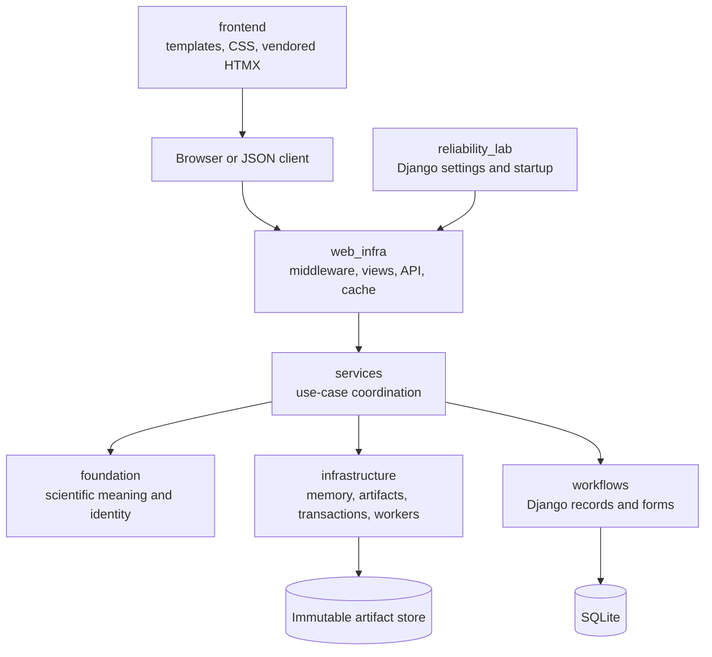

# MyDjangoCS-Infrastructure

> We crash workers on purpose.

What happens if a worker dies halfway through a calculation? What actually made it to disk?
Can we run the same job again and trust the result?

MyDjangoCS-Infrastructure is a small Django systems lab for those questions. It follows one
fictional measurement study from raw observations to an admitted computation, an immutable
result, and a replay in a separate job. Django and HTMX make the lifecycle visible in a
browser; the scientific meaning lives in a framework-independent foundation.

The experiment uses four synthetic sensors and two transparent mean calculations. That
scientific surface is intentionally modest. A complicated model would make it harder to see
whether a changed result came from new evidence, a different policy, a stale worker, damaged
storage, or the model itself. Using deterministic means instead of a learned predictor
keeps training-data dependence and model-fit uncertainty out of a reliability experiment.
Here, every stage is small enough to inspect and every identity can be reproduced.

## Seven parts, one investigation

Seven parts own seven different responsibilities. The rules that define an investigation
stay separate from the machinery that runs it. This resembles the useful part of a layered
database design: the upper layer can compose a task without becoming a second implementation
of the lower layer's contracts.
SQLAlchemy's account of its Core/ORM split is a helpful discussion of why a rich lower-level
contract should remain visible rather than be hidden by a convenient adapter
([The Architecture of Open Source Applications](https://aosabook.org/en/v2/sqlalchemy.html)).



`foundation/` defines canonical bytes, scientific schemas, semantic identity,
reconstruction, numerical policy, admission, binary interchange, and the stable Python API.
It imports neither Django nor application services. That is more than a directory choice:
architecture tests reject dependencies that would allow an HTTP view or database model to
quietly redefine scientific meaning.

`infrastructure/` provides mechanisms whose correctness matters to the foundation but whose
implementation should not alter it: scoped memory borrowing, immutable artifact publication,
bounded SQLite write windows, worker claims, fencing, and reconciliation. `services/` joins
those mechanisms to persistent records. `web_infra/` adapts the same services to HTML, HTMX,
and versioned JSON. `frontend/` contains presentation assets; `workflows/` retains the Django
application label, models, forms, migrations, commands, and tests; `reliability_lab/` contains
the Django project configuration and process entry points.

This separation costs a few more calls and types than putting everything in a view or model.
It buys one property the experiment needs: the same evidence and declaration can be checked
without starting Django, while Django can record operational history without becoming the
authority for a scientific result.

## From observations to evidence

The reference corpus contains sixteen observations: four hourly periods for each of four
sensors. Every observation declares its source, timestamp, variable, unit, value, quality,
and missingness. Bravo's third observation is explicitly missing. Charlie's fourth is marked
anomalous. Four declared edges form the graph used by the neighborhood experiment. No edge
is inferred from coordinates or proximity.

Why be so strict about a toy dataset? Consider an empty value arriving through a form. It
could mean a missing observation, a parsing error, or an omitted field. If reconstruction
silently chooses one interpretation, the resulting hash is stable but its meaning is not.
The schema in [`foundation/schema/evidence.py`](foundation/schema/evidence.py) therefore
requires `value=null` and `missing=true` to agree. It rejects duplicate or self-referential
relationships and edges to unknown sensors before any semantic state exists.

Registration creates two related identities. The **content identity** covers the values and
declared relationships. The **provenance identity** covers the source and generator context
while binding back to that content. Equal observations from two declared origins may
reconstruct to the same semantic state without erasing their different provenance. This is
why provenance, content, and state are separate records instead of one convenient hash.

## Canonical bytes before hashes

Hashes don't settle semantics. A SHA-256 digest only identifies the bytes it receives. It
says nothing about whether two
equivalent Python dictionaries were serialized in the same order, whether duplicate JSON
keys were ignored, or whether `-0.0` and `0` were treated consistently. Stable identities
therefore begin with the restricted canonical profile in
[`foundation/contracts/canonical.py`](foundation/contracts/canonical.py).

The profile emits compact UTF-8 JSON, orders object keys by UTF-16 code units, rejects
duplicate keys and binary floating-point tokens, normalizes explicit-offset timestamps to
UTC, and represents schema-controlled decimals as bounded strings. Unicode is preserved
exactly rather than normalized, so NFC and NFD spellings remain distinct source values.

An identity has the visible form:

```text
<domain>:sha256:<digest>
```

The digest covers a framed envelope containing the domain, schema version, and canonical
payload. Domain separation prevents identical payload bytes from being interpreted as both
evidence and a result. Versioning prevents a later contract from inheriting an old identity
by accident. Database UUIDs remain useful locators, but they are not scientific identities:
two jobs can produce the same result identity, while one mutable row can retain its UUID as
its state changes.

## Manifests make reconstruction explicit

Evidence doesn't become semantic state just because it has a digest. A manifest binds the
evidence content, provenance, and reconstruction contract that will interpret it.
Reconstruction then creates stable sensor entities, explicit edges, and time-ordered
observations. The resulting record is serialized, assigned a `semantic-state` identity, and
immediately verified by loading it through the public contract again.

That extra manifest may seem unnecessary when the reconstruction code is local. It answers
a question that a function name alone cannot: *which versioned rules and exact evidence were
used to build this state?* If an observation changes, the content and state identities
change. If only the declared source changes, provenance and manifest identities change while
semantic state may remain equal. The tests exercise both cases.

The accepted reference state is:

```text
semantic-state:sha256:6edea8182bab6fe1d6b9b46fbeab87332e60b6a21596ffb0a5093b71ac188a83
```

## A computation is a closed declaration

A job should say exactly what it intends to run. The reference study implements
`time-window-mean/1` and
`graph-neighborhood-mean/1`. Both use `Decimal` with precision 28,
`ROUND_HALF_EVEN`, and six-place result quantization. Missing values are either excluded or
propagated according to the declaration; the implementation never chooses a policy from the
shape of the data.

Before execution, the verification pipeline closes five questions in order:

1. **Structural:** are the fields, versions, timestamps, and value shapes valid?
2. **State:** does the declared state artifact load and verify to the stated identity?
3. **Semantic:** do the targets, variable, unit, and time window exist and agree?
4. **Method:** is the versioned method valid with these parameters and missing-data rules?
5. **Resource:** are target and record counts within the admitted budget?

Only a declaration that passes all five stages becomes an `Admission`. Parsing a request is
not authorization, and possessing a state artifact is not authorization. The admission
binds the investigation identity, state identity, and computation identity that a worker may
execute.

## The worked investigation

The browser demo follows one deliberately small study. The default declaration selects all
four periods for `sensor_alpha` and
`sensor_bravo`, requests the time-window mean, and chooses the `exclude` policy for explicit
missingness.

Alpha contributes `10`, `11`, `12`, and `13`, producing `11.5`. Bravo contributes `20`,
`21`, and `23`; its third observation remains recorded as missing and is excluded by policy,
producing `21.333333`. The result payload binds those values to the admission, computation,
and semantic-state identities. Its verified identity is:

```text
result:sha256:7d32c02fdb42164d1d1f681906afbe27c380240ec61dc57ba62923ced7adf291
```

`run_reference_experiment` admits the same declaration under two independent idempotency
keys. The two jobs have different UUIDs and attempt histories, but the result identity is the
same because job identity is absent from the scientific result contract. Reproducibility is
thus tested across independent operational records rather than by hashing one output twice.

## Memory ownership as a runtime experiment

Python usually keeps lifetime rules out of sight. This experiment brings them back into view,
because binary work can turn mistakes into stale references or overlapping mutation.
The arena in [`infrastructure/memory/`](infrastructure/memory/) makes those rules visible in
ordinary Python. An allocation receives a slot and generation. Shared borrows may coexist;
an exclusive borrow requires a mutable allocation with no readers or writer. A borrow token
expires when its context exits. Sealing produces owned immutable bytes. Release requires no
active borrow and invalidates the generation before the slot can be reused.

For example, a handle for slot 2, generation 4 cannot access a later allocation that happens
to reuse slot 2 as generation 5. A writer requested while readers are active receives a
controlled `BorrowConflict`, and a token used after its context receives a
`MemoryContractError`.

The terminology is informed by the ownership and borrowing presentation in
[The Rust Programming Language](https://doc.rust-lang.org/book/ch04-02-references-and-borrowing.html),
but the guarantee is different. Rust checks references and lifetimes during compilation.
This arena checks cooperating callers at runtime inside one Python process. It provides no
native memory isolation and exposes no raw address or writable `memoryview`.

## A portable binary record, not a native ABI

The observation format is intentionally boring: fixed, bounded, and easy to verify. Its
52-byte little-endian
header records an eight-byte magic value, format version, flags, record count, payload
length, and a SHA-256 checksum. Each 40-byte record contains a bounded ASCII sensor ID, UTC
epoch milliseconds, a signed fixed-point value scaled by one million, explicit missing and
quality fields, and reserved zero bytes.

Encoding sorts by sensor and timestamp. Decoding checks the complete length, checksum,
codes, sentinel agreement, identifier encoding, and timestamp precision. Bit corruption,
truncation, unknown flags, and sub-millisecond timestamps fail instead of being repaired or
rounded silently.

This is an interchange contract, not a native ABI. It defines bytes on disk; it does not
define pointers, compiler alignment, an in-process calling convention, or a C structure.
Golden vectors protect that distinction across Windows, Linux, and supported Python
versions.

## Immutable bytes and mutable records

There are two stores here, so one transaction can't cover everything. Scientific artifacts
are stored by content digest. Publication writes a temporary file,
flushes it, and exposes it with a same-filesystem hard link. If another writer wins the same
path, the bytes must match. Reads are incremental and bounded, then recheck size, digest,
and full artifact identity. The design follows the general observation that immutable
structures are easier to reason about after failure; the DBDB chapter in *500 Lines or
Less* develops that idea through a small persistent system
([DBDB: Dog Bed Database](https://aosabook.org/en/500L/dbdb-dog-bed-database.html)).

SQLite records what an artifact means and how it participates in a run. The filesystem
stores the bytes. No local transaction can commit both domains atomically. A process can die
after publishing a result block but before registering it or completing the job row.

The laboratory treats that gap as evidence, not success. Reconciliation reports the extra
block as an orphan. It may be quarantined by an explicit operator action, but it cannot be
promoted automatically because no committed admission, claim, or finalization says that it
is authoritative. Conversely, a registered artifact whose bytes are missing or corrupt is
marked accordingly and cannot be served from database JSON as a fallback.

## Claims, transactions, and fencing

Jobs move through `admitted → running → succeeded|failed|interrupted`. SQLite's
`select_for_update()` does not provide row locking, so worker claims use short
`BEGIN IMMEDIATE` write windows plus conditional updates. Calculation happens outside that
critical section. The commit process remains SQLite's responsibility; its atomic-commit
documentation is useful background for understanding why application code should keep the
transaction boundary explicit and short
([Atomic Commit in SQLite](https://www.sqlite.org/atomiccommit.html)).

A scientific claim increments a generation and creates a random owner token. Finalization
must match the job state, attempt number, generation, and token. Suppose a worker stalls,
the owner confirms that it has stopped, and recovery marks the attempt interrupted. A new
claim receives a new generation and token. Even if the old process resumes, its conditional
finalization cannot match the current ownership record.

Age alone never proves that a process is dead. Recovery therefore requires out-of-band
confirmation and never retries arbitrary external effects automatically. Process tests kill
real Python subprocesses before claim commit, during calculation, after artifact
publication, after result commit, and during recovery. They reopen the database and store to
observe what survived. This resembles the case-study approach used to explain component
responsibilities and failure handling in *A Continuous Integration System*
([500 Lines or Less](https://aosabook.org/en/500L/a-continuous-integration-system.html)),
while the implementation here remains deliberately single-host.

## Cache and HTTP delivery remain subordinate

The cache gets no vote. A cache entry is a rendered representation, not a scientific record.
Only a succeeded job
with a reverified result artifact can be cached. The key includes the job, artifact identity,
and representation variant. Full HTML and HTMX fragments cannot cross because responses
vary on `HX-Request`; mutable, failed, and interrupted jobs bypass result caching.

Django applies middleware top-down on the request and in reverse on the response. A
component may return early without invoking the inner chain, which is exactly what the
demonstration guard does for `X-Lab-Short-Circuit: 1`
([Django middleware documentation](https://docs.djangoproject.com/en/5.2/topics/http/middleware/)).
The observed normal trace is:

```text
trace.enter>guard.pass>view.home>trace.exit
```

The short-circuit trace is:

```text
trace.enter>guard.block>trace.exit
```

Correlation IDs are accepted only under a bounded header-safe grammar. The trace middleware
also reports elapsed time and `Server-Timing`. HTMX requests use the same URLs, forms, CSRF
tokens, and services as ordinary HTML; they differ only in the returned fragment. The JSON
API under `/api/v1/` is another adapter over those services, not a second computation path.

## Run the lab

Python 3.12 and 3.13 are the qualified versions. The application is intended for trusted,
single-user use on loopback.

### Windows PowerShell

```powershell
py -3.12 -m venv .venv
.\.venv\Scripts\python.exe -m pip install -r requirements.txt
.\.venv\Scripts\python.exe manage.py migrate
.\.venv\Scripts\python.exe manage.py runserver 127.0.0.1:8000
```

### Linux

```bash
python3.12 -m venv .venv
./.venv/bin/python -m pip install -r requirements.txt
./.venv/bin/python manage.py migrate
./.venv/bin/python manage.py runserver 127.0.0.1:8000
```

Open <http://127.0.0.1:8000/lab/> for the scientific investigation. The root
<http://127.0.0.1:8000/> exposes the smaller dynamic-workflow reliability experiment.

The management commands each answer a different operational question:

```powershell
# Build the synthetic evidence, execute two independent jobs, and compare results.
.\.venv\Scripts\python.exe manage.py run_reference_experiment

# Reverify registered artifact bytes and report missing, corrupt, or orphaned blocks.
.\.venv\Scripts\python.exe manage.py reconcile_artifacts

# Claim and execute one admitted workflow job.
.\.venv\Scripts\python.exe manage.py run_jobs --once

# Interrupt stale jobs only after confirming that their workers have stopped.
.\.venv\Scripts\python.exe manage.py recover_jobs `
  --older-than-seconds 60 --confirm-worker-stopped

# Measure the fixed synthetic workload; this is not a capacity benchmark.
.\.venv\Scripts\python.exe manage.py benchmark_lab --iterations 25
```

Replace `.\.venv\Scripts\python.exe` with `./.venv/bin/python` on Linux.

For a development environment, install `requirements-dev.txt`, install Playwright's
Chromium browser, and run the same checks used by CI:

```powershell
.\.venv\Scripts\python.exe -m pip install -r requirements-dev.txt
.\.venv\Scripts\python.exe -m playwright install chromium
.\.venv\Scripts\python.exe manage.py check
.\.venv\Scripts\python.exe manage.py makemigrations --check --dry-run
.\.venv\Scripts\python.exe manage.py test workflows.tests -v 2
.\.venv\Scripts\ruff.exe check .
.\.venv\Scripts\python.exe -m pip check
```

See [conformance](docs/CONFORMANCE.md) for the independent expected values and
[experiments](docs/EXPERIMENTS.md) for the failure-injection evidence.

## What the evidence says (and doesn't)

The checked-in suite covers canonical and numerical vectors, schema rejection, memory
lifecycle properties, binary corruption, artifact races, transaction rollback, independent
SQLite connections, real subprocess termination, cache variation, versioned API behavior,
and six Chromium workflows. GitHub Actions runs the complete suite on Windows and Ubuntu
with Python 3.12 and 3.13. The released v0.1.0 source is
`f59da3b0722195db350c2856ceaedc36ec1b6fb9`; GitHub Actions run `41281782301` passed all
four jobs on that exact commit.

These experiments support bounded claims about this implementation and its fixtures. They
do not provide distributed consensus, arbitrary external-effect exactly-once execution,
Rust's compile-time ownership guarantees, a production multi-user security model, or
validated physical simulation. SQLite, a local artifact directory, and Django's local-memory
cache were chosen to expose failure boundaries on one host, not to imitate a distributed
platform. The server has no authentication, TLS termination, tenant isolation, or shared
deployment contract.

The scientific corpus is fictional. Deterministic replay shows that declared bytes and
policies lead to the same result; it does not show that graph adjacency represents physical
communication, that the reference means predict a real process, or that a software invariant
is a scientific conclusion.

## Documentation and sources

- [Architecture and authority boundaries](docs/ARCHITECTURE.md)
- [Normative contracts](docs/CONTRACTS.md)
- [Conformance vectors and reproduction](docs/CONFORMANCE.md)
- [Adversarial experiments](docs/EXPERIMENTS.md)
- [Reference and licensing boundary](docs/REFERENCE_BOUNDARY.md)
- [Reviewed publication manifest](docs/PUBLICATION_MANIFEST.md)
- [Editorial research note](docs/EDITORIAL_RESEARCH.md)
- [v0.1.0 release notes](RELEASE_NOTES.md)

The explanatory documents and compact reference documents are kept separate following the
useful distinction described by [Diátaxis](https://diataxis.fr/reference-explanation/): the
README and architecture chapter develop understanding, while contracts and conformance
material are designed for consultation during implementation and review.

Independently authored code is licensed under [MIT](LICENSE). The vendored HTMX asset keeps
its Zero-Clause BSD terms; see [THIRD_PARTY_NOTICES.md](THIRD_PARTY_NOTICES.md). The restricted
WellNet archive and detailed local research report are excluded from the repository and are
not required to understand or run the laboratory.
