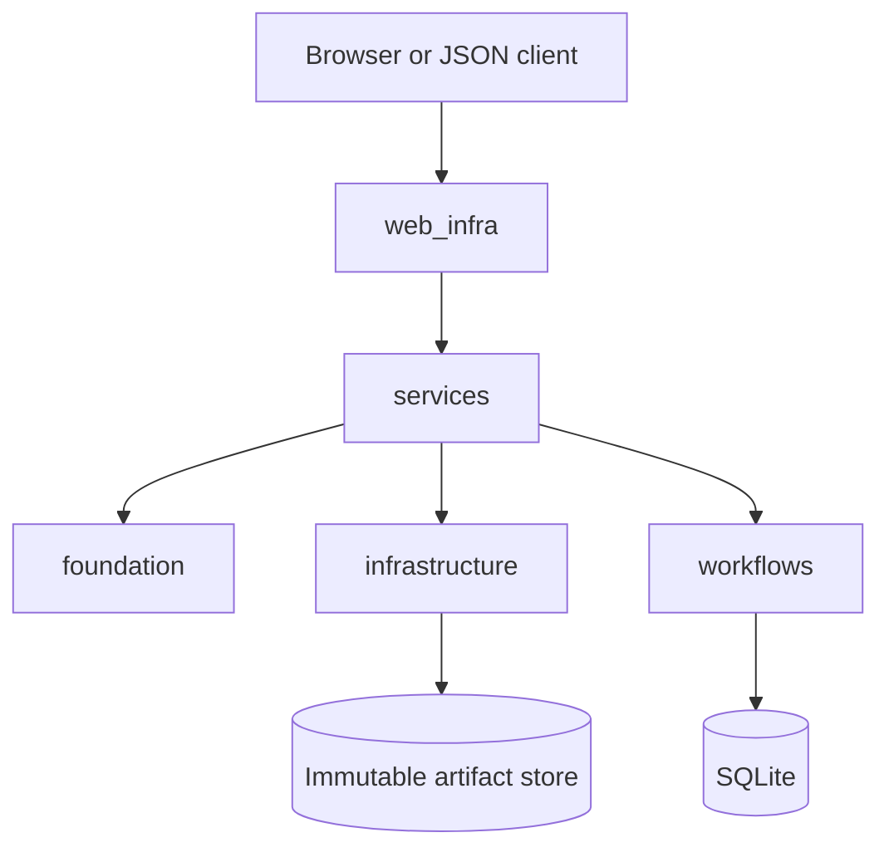

# MyDjangoCS-Infrastructure

> We crash workers on purpose.

What happens if a worker dies halfway through a calculation? What made it to
disk? Can the same job run again without creating a second authoritative
result?

MyDjangoCS-Infrastructure is a small Django systems lab for investigating those
questions. It follows one fictional measurement study from raw observations to
an admitted computation, immutable result bytes, and a replay in a separate
job. Django and HTMX make the lifecycle visible in a browser; the scientific
meaning lives in a framework-independent foundation.

The calculation is intentionally simple: four synthetic sensors and two mean
values. That keeps failures in identity, persistence, worker ownership, or
recovery visible instead of burying them under a complicated model.

## What the lab exercises

- Canonical JSON and domain-separated SHA-256 identities
- Versioned evidence, manifests, and deterministic reconstruction
- Explicit numerical policy with independent conformance values
- Bounded memory ownership and a portable binary observation format
- Immutable content-addressed artifacts with SQLite authority records
- Idempotent admission, atomic worker claims, attempt generations, and fencing
- Real subprocess termination and controlled recovery
- Full-page, HTMX, and JSON interfaces over the same application services
- Cache isolation between mutable job state and immutable results

It is deliberately a one-host experiment. There is no Redis, Celery,
distributed scheduler, hosted backend, or claim of arbitrary exactly-once
execution.

## One investigation, several boundaries



`foundation/` defines evidence schemas, canonical bytes, semantic identity,
reconstruction, numerical rules, binary interchange, and the stable Python
API. It does not import Django.

`infrastructure/` owns memory borrowing, immutable artifact publication,
SQLite write boundaries, worker claims, fencing, and reconciliation.
`services/` coordinates those mechanisms. `web_infra/` adapts the same
services to HTML, HTMX, and `/api/v1/`; `workflows/` contains the Django
records, forms, migrations, commands, and tests.

The separation matters because a view or database row must not quietly redefine
the scientific result. The same evidence and declaration can be verified
without starting Django.

## Identity before execution

Hashes identify bytes, not meaning. The canonical profile therefore fixes
UTF-8 JSON serialization, key ordering, timestamp handling, decimal forms, and
duplicate-key rejection before an identity is calculated. Identities include a
domain and schema version:

```text
<domain>:sha256:<digest>
```

An admitted command is a closed declaration: evidence identity, method,
numeric policy, and ordered operations are fixed before a worker can claim it.
The idempotency scope and key identify the request; the command digest proves
whether a repeated key carries the same content. Reusing a key with different
content fails instead of silently changing the job.

## Bytes, rows, and crashes

Result bytes are staged, published immutably, verified, and then registered in
SQLite. The filesystem and database cannot share one atomic transaction, so a
crash can leave an unregistered artifact. Reconciliation reports missing,
corrupt, and orphaned bytes rather than pretending the gap cannot happen.

Workers claim jobs with an atomic conditional update. Every attempt receives a
new generation and owner token. Finalization requires the current token, so a
stale worker cannot overwrite a recovered attempt. Recovery is manual and
requires confirmation that the previous worker has stopped; the lab does not
automatically replay unknown external effects.

The memory experiment uses generation-checked handles, scoped reads and writes,
borrow conflicts, and deterministic release. These are runtime checks in
Python, not Rust's compile-time lifetime guarantees. The binary observation
format specifies byte order, field widths, lengths, checksum behavior, and
schema version rather than exposing a native in-memory ABI.

## Worked result

The fictional corpus has sixteen observations from four sensors. One Bravo
observation is explicitly missing and is excluded by policy. The reference
calculation produces:

| Sensor | Mean |
| --- | ---: |
| Alpha | `11.5` |
| Bravo | `21.333333` |

Independent jobs replay to the same result identity:

```text
result:sha256:7d32c02fdb42164d1d1f681906afbe27c380240ec61dc57ba62923ced7adf291
```

That establishes repeatability for the declared bytes, policies, and
implementation. It does not validate a physical model.

## Run the lab

Python 3.12 and 3.13 are qualified. The server is intended for trusted,
single-user use on loopback.

### Windows PowerShell

```powershell
py -3.12 -m venv .venv
.\.venv\Scripts\python.exe -m pip install -r requirements.txt
.\.venv\Scripts\python.exe manage.py migrate
.\.venv\Scripts\python.exe manage.py runserver 127.0.0.1:8000
```

### Linux

```bash
python3.12 -m venv .venv
./.venv/bin/python -m pip install -r requirements.txt
./.venv/bin/python manage.py migrate
./.venv/bin/python manage.py runserver 127.0.0.1:8000
```

Open <http://127.0.0.1:8000/lab/> for the scientific investigation. The root
<http://127.0.0.1:8000/> contains the smaller dynamic-workflow reliability
experiment.

Useful management commands:

```powershell
.\.venv\Scripts\python.exe manage.py run_reference_experiment
.\.venv\Scripts\python.exe manage.py reconcile_artifacts
.\.venv\Scripts\python.exe manage.py run_jobs --once
.\.venv\Scripts\python.exe manage.py recover_jobs `
  --older-than-seconds 60 --confirm-worker-stopped
.\.venv\Scripts\python.exe manage.py benchmark_lab --iterations 25
```

The benchmark command measures one fixed synthetic workload. It is not a
capacity or production-performance claim.

## Run the checks

```powershell
.\.venv\Scripts\python.exe -m pip install -r requirements-dev.txt
.\.venv\Scripts\python.exe -m playwright install chromium
.\.venv\Scripts\python.exe manage.py check
.\.venv\Scripts\python.exe manage.py makemigrations --check --dry-run
.\.venv\Scripts\python.exe manage.py test workflows.tests -v 2
.\.venv\Scripts\ruff.exe check .
.\.venv\Scripts\python.exe -m pip check
```

The checked-in suite includes canonical and numerical vectors, schema
rejection, memory lifecycle checks, binary corruption, artifact races,
transaction rollback, independent SQLite connections, subprocess termination,
cache variation, API behavior, and six Chromium workflows. GitHub Actions runs
the suite on Windows and Ubuntu with Python 3.12 and 3.13.

## Limits

The lab does not provide distributed consensus, arbitrary external-effect
exactly-once execution, compile-time ownership guarantees, a multi-user
security model, or scientific validation of a physical process. The corpus is
fictional. The loopback server has no authentication, TLS termination, tenant
isolation, or shared deployment contract.

## Read deeper

- [Architecture and failure boundaries](docs/ARCHITECTURE.md)
- [Deterministic foundation contracts](docs/CONTRACTS.md)
- [Conformance vectors and independent reproduction](docs/CONFORMANCE.md)
- [Adversarial experiments](docs/EXPERIMENTS.md)
- [Source and reference boundary](docs/REFERENCE_BOUNDARY.md)
- [Public source manifest](docs/PUBLICATION_MANIFEST.md)
- [v0.1.0 release notes](RELEASE_NOTES.md)

Independently authored code is licensed under [MIT](LICENSE). The vendored HTMX
asset retains its Zero-Clause BSD terms; see
[THIRD_PARTY_NOTICES.md](THIRD_PARTY_NOTICES.md).
