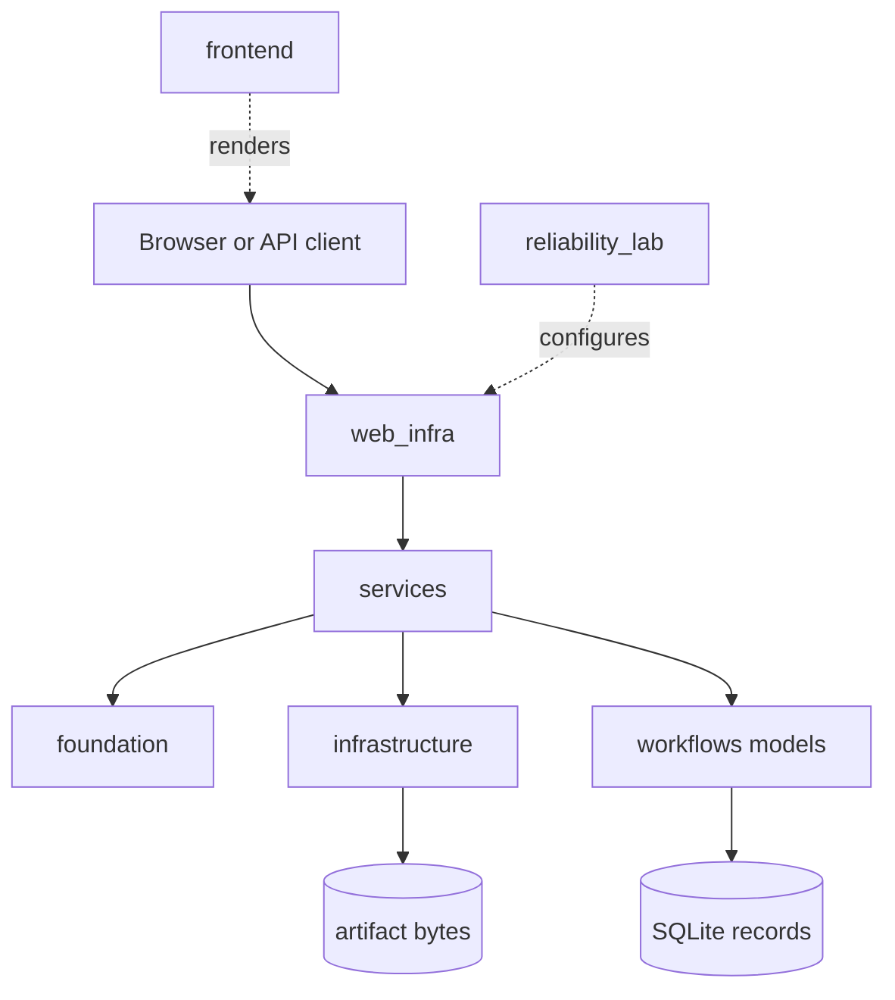
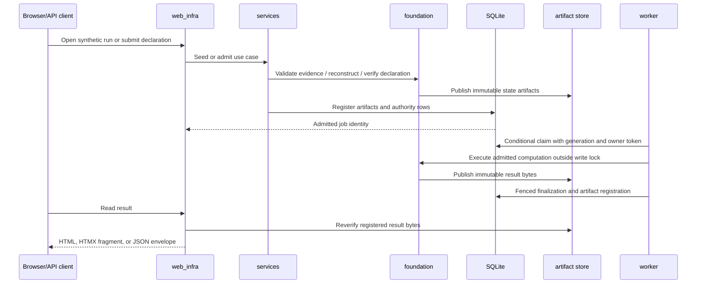

# Architecture

MyDjangoCS-Infrastructure has one architectural objective: preserve the meaning and evidence
of a deterministic scientific computation while it crosses components with different
failure and lifetime rules.

An HTTP request may last milliseconds. A Python allocation may be released and its slot
reused. A filesystem block may survive a process crash that rolls back SQLite. A job row may
change from admitted to running while the scientific state it references must never change.
The architecture does not pretend those resources share one transaction. It makes the
boundaries explicit and defines what can become authoritative at each one.

## Responsibility map



| Layer | Owns | Must not own |
| --- | --- | --- |
| `foundation` | schemas, canonical bytes, scientific identities, reconstruction, numerical methods, admission, binary contract, public API | HTTP, Django models, worker state, cache policy |
| `infrastructure` | memory arena, artifact store, database transaction helpers, claims and recovery mechanisms | scientific meaning, presentation, use-case policy |
| `services` | application use cases and coordination across foundation, storage, and records | HTML rendering, duplicated scientific algorithms |
| `web_infra` | middleware, views, versioned API envelopes, response caching | authoritative computation or worker scheduling |
| `frontend` | Django templates, CSS, vendored HTMX | scientific state or persistence rules |
| `workflows` | Django models, forms, migrations, commands, tests | a second scientific foundation |
| `reliability_lab` | Django settings, URL composition, ASGI/WSGI startup | domain behavior |

The architecture-boundary tests parse imports and reject dependencies that would invert
this order. These tests do not prove the design is ideal, but they prevent an easy form of
drift: importing a view or model into the framework-independent core for convenience.

## Five identities that should not be confused

The system uses several identities because they answer different questions.

1. A **database UUID** locates one operational record. It can remain stable while a job's
   mutable state changes.
2. An **evidence content identity** answers which observations and declared relationships
   were supplied.
3. A **provenance identity** answers which declared source context accompanies that content.
4. A **semantic-state identity** answers which reconstructed scientific state is being used.
5. A **result identity** answers which verified output followed from a particular admission,
   computation, and state.

These identities are deliberately not aliases. Two idempotency keys create distinct job
UUIDs but can produce the same result identity. A provenance edit can change the provenance
and manifest identities without changing semantic state. A mutable job cannot become an
immutable result merely because its JSON field currently contains similar values.

## State authority and operational state

The foundation's semantic state is immutable and content identified. It consists of
validated entities, observations, edges, and the evidence identities that produced them.
Its stored representation is reloaded and reverified before admission.

Operational state lives in SQLite. `ResearchRun`, `InvestigationRecord`, `AdmissionRecord`,
`Job`, `ExecutionAttempt`, `JobEvent`, and `ArtifactRecord` describe how work was requested
and what the application observed. Those records have different mutability rules:

- admitted command bytes and their scientific bindings are immutable;
- job lifecycle and ownership fields change through guarded transitions;
- attempt and event history is append-oriented and ordered;
- a result becomes authoritative only when verified artifact registration and the succeeded
  transition commit together.

Operational records may point to authority; they do not redefine it. A job's primary key is
not included in the scientific result identity, and cached HTML is not consulted during
scientific verification.

## Immutable artifacts and mutable lifecycle rows

The artifact store and SQLite intentionally solve different problems.

The store publishes immutable bytes at a path derived from a SHA-256 payload digest. A write
is bounded, flushed to a temporary file, and made visible with a same-filesystem hard link.
An existing destination is accepted only if its bytes verify. Reads check the declared size,
digest, and complete artifact identity before returning data.

SQLite records the artifact's type, schema, size, digest, verification state, and
relationship to a research run or job. Its transaction can also update attempt and event
records atomically. SQLite cannot, however, include the filesystem link operation in its
commit. The application therefore accepts a one-way gap: bytes may exist without an
authoritative row. It never accepts the opposite as a valid result.

This distinction is central to crash recovery. Immutable bytes can be rechecked after a
restart. Mutable lifecycle rows can say whether the process had earned the authority to use
those bytes.

## Request path: from browser to verified result

The scientific path is chronological and intentionally narrow.



The middleware path wraps the delivery portion only. `SecurityMiddleware` is outermost,
followed by tracing, Django common handling, CSRF checks, HTMX request classification, and
the demonstration guard. A normal request enters in that order and exits in reverse.
Short-circuiting the guard avoids the view and domain services; it cannot change a job.

HTML and JSON use the same service operations. HTMX changes the representation selected by
the view, not the admission or execution rules. This keeps progressive enhancement from
becoming a second authority path.

## Computation is not worker admission

`FoundationAPI.execute()` is a deterministic computation over an `Admission` and a verified
state. It does not know whether a worker has claimed a job, whether a retry is allowed, or
whether a result should be registered in SQLite.

The worker lifecycle is separate:

```text
admitted -> running -> succeeded
                    -> failed
                    -> interrupted

failed|interrupted -> admitted   (explicit requeue only)
```

Claims occur in short `BEGIN IMMEDIATE` write windows. The conditional update requires the
job to be admitted and records an incremented claim generation, owner token, attempt, and
event. Calculation runs after the transaction commits. Finalization requires the same job,
running state, attempt number, generation, and token. A recovered or superseded claim cannot
finalize even if its process later resumes.

This supports at most one accepted success transition for the tested single-host SQLite
model. It does not create distributed consensus or exactly-once execution for arbitrary
external effects. Recovery also requires explicit confirmation that the old worker has
stopped; elapsed time alone is insufficient evidence.

## Failure study: bytes published before the result row

The most instructive failure occurs between two durable systems.

1. A worker has a valid fenced claim and computes the reference result.
2. `ArtifactStore.publish()` writes and exposes the content-addressed result bytes.
3. The process is terminated before `register_artifact()` and the succeeded transition
   commit in SQLite.
4. After restart, the job remains `running`. Its attempt is not successful, its result fields
   are empty, and SQLite contains no result artifact record.
5. Reconciliation scans the store and finds one digest that no `ArtifactRecord` references.
   It reports that digest as an orphan.
6. The orphan is not promoted. Bytes alone do not prove which claim produced them, whether
   final verification completed, or whether an operator intended to accept them.
7. After the owner confirms that the worker stopped, recovery fences the old claim and marks
   the attempt interrupted. An explicit requeue creates a new admitted lifecycle. A new
   execution may publish the same deterministic bytes and complete a valid finalization.

The process test
`test_published_result_without_database_commit_is_recoverable_orphan` uses an actual child
process exit code 91 at step 3, reopens the database and store, observes the orphan, performs
recovery and requeue, and verifies the successful result identity. The failure is not modeled
as an ordinary caught exception.

## Verified result and cache are different objects

Before a result is served, `verify_scientific_result()` loads the registered artifact,
rechecks its store invariants, parses strict JSON, and compares the embedded identity with
the job's committed result identity. A missing or corrupt artifact produces a controlled
failure; database JSON is not a substitute for verified bytes.

Only then may the web layer cache a rendered representation. Its key binds:

- the job UUID,
- the immutable result artifact identity, and
- the representation variant (`page` or `fragment`).

Full pages and HTMX fragments therefore cannot cross. The response is private and varies on
`HX-Request`. Pending, running, failed, and interrupted jobs never enter this cache. Clearing
the cache loses an optimization and nothing authoritative.

## Memory and binary boundaries

The memory arena is a bounded runtime ownership experiment. Handles contain a slot and a
generation. The arena enforces shared-reader/exclusive-writer rules, expires scoped tokens,
requires owned immutable bytes at its public boundary, and refuses release while borrowed.
It is useful for demonstrating stale-handle and aliasing failures; it is not a replacement
for Rust's compiler or operating-system memory protection.

The binary observation format is likewise explicit but modest. It uses a 52-byte little-
endian header and fixed 40-byte records. It defines portable stored bytes, not a native ABI
or Python object layout. The decoder is bounded and rejects truncation, checksum mismatch,
invalid sentinels, identifiers, flags, and timestamp precision.

## Selected trade-offs

**SQLite instead of a service database.** The local engine makes transactions, locking, and
crash state easy to reproduce. It also limits the concurrency and deployment claims. The
implementation does not pretend that `select_for_update()` provides SQLite row locks.

**Filesystem blocks instead of database blobs.** Content addressing and fault injection are
visible, and large bytes do not extend database write windows. The cost is explicit
cross-domain reconciliation.

**Synchronous single worker instead of a queue.** Claims, fencing, and recovery can be
studied without Redis, Celery, or a distributed scheduler. Progress depends on an operator
or management command.

**A simple mean instead of a complex model.** Independent expected values fit in the
conformance document. The result is a software-reliability experiment, not a claim about
physical modeling.

**Vendored HTMX instead of a frontend build.** The browser experiment works offline with
ordinary HTML forms and no Node.js toolchain. The vendored file retains its own license.

## Trust and deployment boundary

The application binds to loopback in the documented command and uses Django CSRF
protection, security headers, bounded uploads, strict correlation IDs, and private cache
responses. It is nevertheless a trusted local laboratory. There are no accounts, role
checks, tenant boundaries, TLS policy, secret-management integration, or hardened production
settings. Running it on a shared network or treating it as a hosted workflow service would
cross the accepted architecture boundary.

Restricted research material and external source archives are not part of this architecture.
The public repository is independently implemented, runs without those materials, and
contains a precise boundary statement in [REFERENCE_BOUNDARY.md](REFERENCE_BOUNDARY.md).
